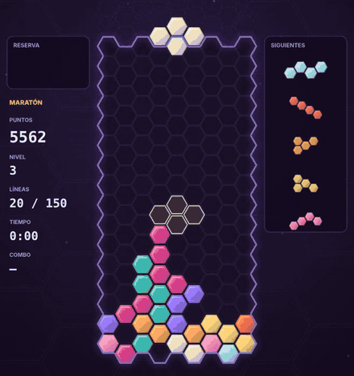
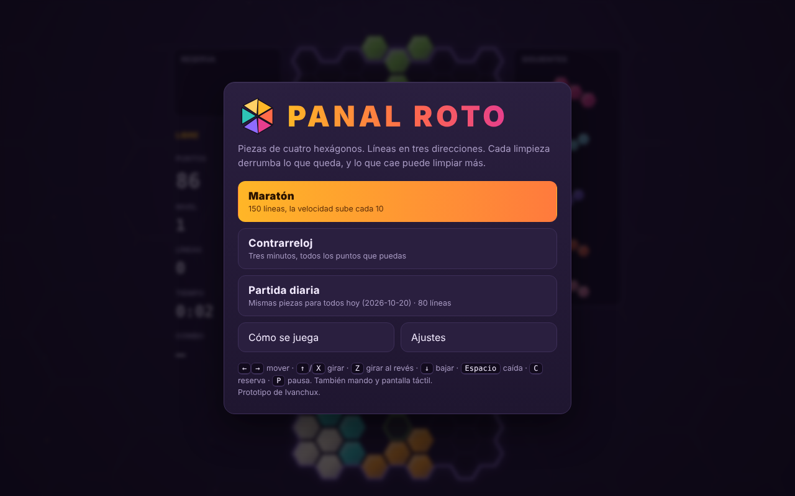
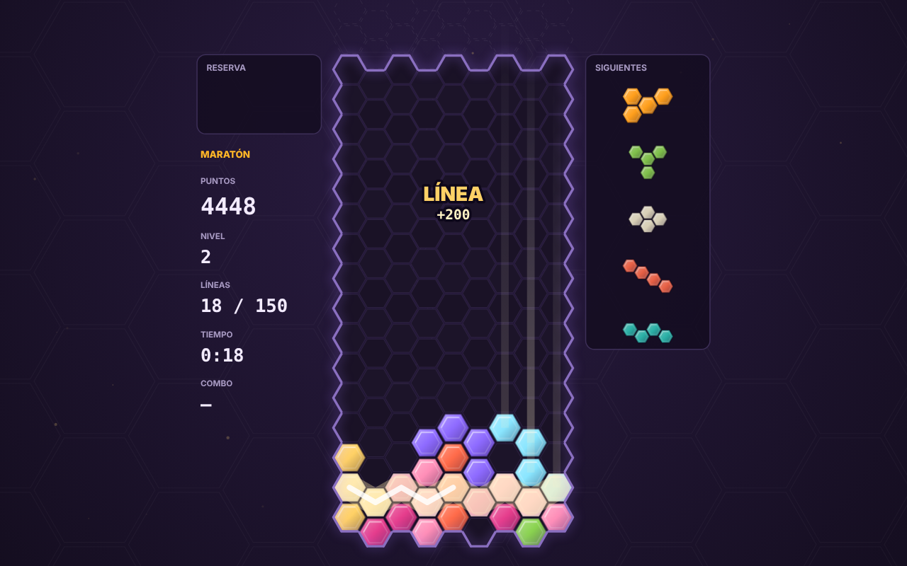
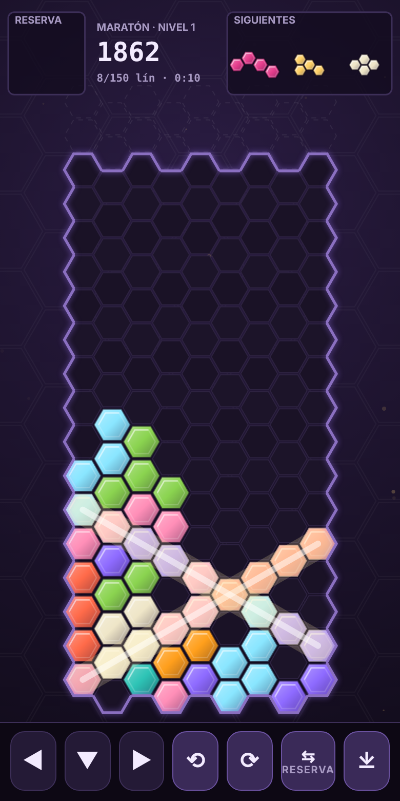

# Panal Roto

Puzle de piezas que caen sobre un tablero hexagonal. Las líneas se cierran en tres direcciones y, tras cada limpieza, lo que queda se derrumba: si al caer se completa otra línea, se limpia sola y encadena.

Un único `index.html`, sin dependencias, con HTML5 + Canvas y sonido sintetizado con Web Audio. Hecho por [Ivanchux](https://github.com/Ivanchux).

**Jugar:** https://ivanchux.github.io/panal-roto/ (una vez activado GitHub Pages en el repositorio; si el repositorio tiene otro nombre, la dirección cambia con él).
También funciona abriendo `index.html` directamente en el navegador.



*Partida con la semilla 33: la pieza número 56 provoca una cadena de cuatro eslabones.*

| Menú | Partida | Móvil |
|---|---|---|
|  |  |  |

## Reglas

**Tablero.** Un panal de 9 columnas por 16 filas. Las columnas impares quedan medio hexágono más abajo, y por eso mover una pieza hacia un lado la sube o la baja media celda.

**Piezas.** Las 10 formas distintas que se pueden hacer con cuatro hexágonos, contando como distintas las imágenes en espejo: Aguijón, Garra I/D, Hoz I/D, Gota, Ola I/D, Antena y Hélice. Giran de 60 en 60 grados, con empujes de pared (*wall kicks*) cuando el giro choca. Salen de una bolsa de las 10 mezcladas con una semilla, así que ninguna se hace esperar demasiado.

**Líneas.** Hay tres tipos, todas de 9 celdas de pared a pared:

- la franja en zigzag, una por fila (16);
- la diagonal `/` (12);
- la diagonal `\` (12).

Una pieza puede cerrar varias a la vez. Si son de direcciones distintas hay cruce: ×1,5 con dos direcciones y ×2 con tres.

**Derrumbe.** Al limpiar, las celdas de las líneas se rompen. Las que sobreviven siguen unidas a las de su misma pieza y caen como un bloque hasta apoyarse. Los huecos bajo un voladizo se conservan mientras algo lo sostenga. Si la caída completa otra línea, se limpia y se vuelve a derrumbar: cada eslabón de la cadena multiplica los puntos (×1, ×2, ×3…).

**Puntos.**

| Líneas a la vez | 1 | 2 | 3 | 4 | 5 | 6 |
|---|---|---|---|---|---|---|
| Base | 100 | 300 | 500 | 800 | 1200 | 1800 |

Más de 6 líneas suman 600 cada una. Se multiplica por el cruce, por el eslabón de la cadena y por el nivel. Además:

- Combo (limpiar en piezas seguidas): 50 × combo × nivel.
- Panal vacío: 3000 × nivel.
- Bajar con la tecla: 1 punto por fila. Caída directa: 2 por fila.

**Nivel y velocidad.** Sube cada 10 líneas hasta el 20. La gravedad pasa de 850 ms por fila en el nivel 1 a 45 ms como mínimo. La pieza tiene 500 ms de margen al apoyarse y hasta 15 reinicios si la mueves o giras.

**Reserva y siguientes.** Una pieza en reserva (*hold*), una vez por pieza, y cola de 5 siguientes. Pieza fantasma opcional.

**Modos.**

- **Maratón:** 150 líneas.
- **Contrarreloj:** 3 minutos, gana quien más puntos haga.
- **Partida diaria:** 80 líneas con las mismas piezas para todos ese día (la semilla sale de la fecha local).

## Controles

| | Acción |
|---|---|
| Teclado | `←` `→` o `A` `D` mover · `↑` o `X` girar · `Z` o `Ctrl` girar al revés · `↓` o `S` bajar · `Espacio` caída directa · `C` o `Mayús` reserva · `P` o `Esc` pausa · `M` silenciar · `R` reiniciar |
| Mando | Cruceta o palanca mover · A girar · B girar al revés · Y caída directa · X o gatillo izquierdo reserva · Start pausa |
| Táctil | Arrastrar a los lados mover · tocar girar · deslizar abajo para caer · deslizar arriba para reserva · botones en pantalla |

En **Ajustes** se pueden regular el retardo de repetición (DAS), la velocidad de repetición (ARR), la caída suave, los controles táctiles, la pieza fantasma, el nivel inicial y el volumen de música y efectos.

## Accesibilidad

- **Modo para daltónicos:** paleta elegida con simulación de protanopia, deuteranopia y tritanopia (diferencia de color mínima entre piezas ΔE ≥ 18,6) y un dibujo grabado distinto en cada pieza, para no depender solo del color.
- **Reducir movimiento:** sin temblor de pantalla, fragmentos, destellos ni fondo animado. El ritmo de juego no cambia. Se activa solo si el sistema lo pide (`prefers-reduced-motion`).
- Los eventos importantes se anuncian en una región `aria-live`, y todo el menú se maneja con teclado.

## Qué lo hace distinto

- Tablero hexagonal propio, con líneas en tres direcciones.
- Conjunto de 10 piezas de cuatro hexágonos, distinto de los clásicos tetrominós.
- Derrumbe por cuerpos rígidos y cadenas como regla central.
- Nombre, paleta (miel, coral, rosa, menta, violeta), interfaz, música y efectos propios.
- Código, gráficos y sonido escritos desde cero; no hay imágenes, fuentes ni audio externos.

Esto es una decisión de diseño para mantener distancia, no un dictamen legal: nadie que lo haya escrito es abogado.

## Cómo se ha probado

Todo lo que se puede comprobar sin una persona delante:

- **Reglas del motor:** 94 comprobaciones (piezas, giros, empujes, bloqueo, fantasma, puntuación, derrumbe).
- **Bots con semilla fija:** 3060 partidas aleatorias y 150 con un bot heurístico, 54 829 piezas y 24 101 líneas, con cadenas de hasta 4 eslabones. En cada paso se comprueban invariantes del tablero (conservación de celdas, colisiones, límites) y no apareció ningún estado imposible.
- **Navegador (Chromium, sin interfaz):** 30 comprobaciones sobre modos, semilla diaria reproducible, ajustes guardados, DAS/ARR, giros, reserva, pausa, fin de partida, victoria, tiempo agotado, mando simulado, botones y gestos táctiles. Sin errores en consola.
- **Determinismo:** la misma semilla con las mismas teclas da el mismo tablero, líneas, piezas, cola y reserva en Node y en Chromium. La puntuación difiere en unos puntos de caída directa porque la gravedad en el navegador va en tiempo real.
- **Rendimiento:** fotograma mediano de 16,7 ms, p95 de 16,8 ms (con render por software, sin GPU).
- **Audio:** medido con un analizador en Chromium: todos los efectos suenan y ninguno satura.

Para repetirlo (Node 18+, Python 3 con Playwright y Chromium):

```sh
sh pruebas/todo.sh
```

## Límites conocidos

- El tacto y la diversión no se han podido juzgar; la curva de velocidad y la dificultad se ajustan jugando. Los bots lo colocan casi todo bien, así que la dificultad real viene de la velocidad.
- Solo se ha verificado en Chromium. Firefox, Safari y dispositivos reales (móvil, mando físico) están sin probar.
- El sonido se ha medido, pero no escuchado con altavoces.
- La partida diaria usa la fecha local: en husos horarios distintos la semilla cambia a horas distintas.

## Estructura

```
index.html     el juego completo (lo único que hace falta para jugar)
src/           fuentes: motor, render, audio, app, estilos, plantilla
build.mjs      genera index.html a partir de src/  (node build.mjs)
pruebas/       tests, bots y scripts de navegador
capturas/      imágenes y GIF de este README
```

El motor (`src/engine.js`) es puro y determinista, y no toca el DOM: por eso se puede probar desde Node.
